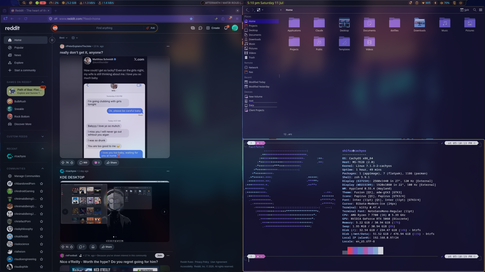
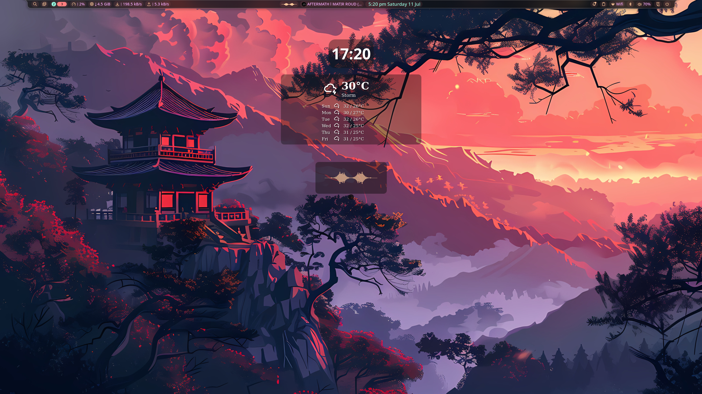
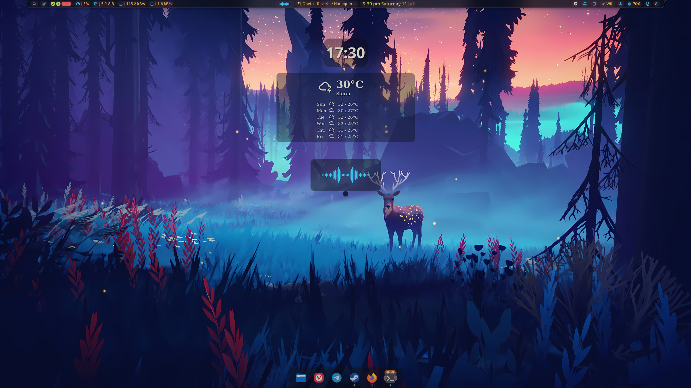

# noctalia-v5-dotfiles

My **Hyprland + Noctalia v5** desktop on CachyOS (Wayland, NVIDIA). Lua-native
Hyprland config, Noctalia v5 shell (TOML), zsh + Powerlevel10k, and a full
Noctalia v5 reference guide in [`docs/`](docs/).

> Noctalia v5 is a fresh, native shell (the `noctalia` binary + `noctalia msg` IPC) —
> **not** the old Quickshell v4 line. These configs are v5-only.

---

## Showcase







---

## The stack

| Layer | What |
|---|---|
| Compositor | **Hyprland** (CachyOS Lua-native — `hyprland.lua` + `config/*.lua`) |
| Shell / bar / widgets | **Noctalia v5** (`config.toml`) |
| Terminal | kitty |
| Shell (CLI) | zsh + Powerlevel10k (CachyOS zsh config) |
| Screenshots | Noctalia capture → **satty** annotation ([how it works](docs/my-screenshot-setup.md)) |
| Theme | Noctalia palette + app-theming templates |

---

## Dependencies

On CachyOS/Arch. Adjust to your setup — `noctalia` comes from AUR or the CachyOS repos.

**Core**
```bash
sudo pacman -S hyprland xdg-desktop-portal-hyprland kitty dolphin \
               brightnessctl hyprpicker qt6ct nwg-look polkit fastfetch btop
# Noctalia v5 (AUR) + the CachyOS meta that pulls the rest:
paru -S noctalia            # or: sudo pacman -S cachyos-hypr-noctalia
```

**Screenshots & media**
```bash
sudo pacman -S satty grim slurp wl-clipboard wf-recorder
# optional — hardware screen recording used by Noctalia's recorder plugin:
sudo pacman -S gpu-screen-recorder gpu-screen-recorder-ui
```

**Zsh**
```bash
sudo pacman -S zsh zsh-autosuggestions zsh-syntax-highlighting \
               zsh-history-substring-search zsh-completions \
               zsh-theme-powerlevel10k cachyos-zsh-config
```

**Fonts** (used by the bar, widgets, and terminal)
```bash
sudo pacman -S inter-font ttf-jetbrains-mono ttf-bitstream-vera \
               noto-fonts noto-fonts-emoji awesome-terminal-fonts
```

---

## Install

```bash
git clone https://github.com/shifaz-dev/noctalia-v5-dotfiles.git
cd noctalia-v5-dotfiles
./install.sh          # backs up existing config, then symlinks these in
```

`install.sh` symlinks `~/.config/hypr`, `~/.config/noctalia/config.toml`,
`~/.zshrc`, `~/.p10k.zsh`, and copies the wallpapers to `~/Pictures/Wallpaper`.
Anything it replaces is moved to `~/.dotfiles-backup-<timestamp>/`.

> Paths in `config/noctalia/config.toml` (avatar, directories) are hardcoded to
> `/home/shifaz` — edit them for your username. The live Noctalia GUI layer
> (`~/.local/state/noctalia/settings.toml`) is intentionally **not** shipped.

Reload after installing:
```bash
hyprctl reload && noctalia msg config-reload
```

---

## Structure

```
config/
  hypr/            hyprland.lua + config/*.lua, xdph.conf
  noctalia/        config.toml   (exported via `noctalia config export`)
  zsh/             .zshrc, .p10k.zsh
docs/              Noctalia v5 reference (.md + .html) + screenshot setup notes
wallpapers/        pagoda-sunset.jpg, forest-deer.jpg
screenshots/       showcase images
install.sh
```

## Docs

[`docs/noctalia-v5-reference.md`](docs/noctalia-v5-reference.md) is a complete
Noctalia v5 config + IPC reference (config model, bar/widgets, dock, theming,
services, the full `noctalia msg` cheat-sheet, plugins, Hyprland integration).
Open [`docs/noctalia-v5-reference.html`](docs/noctalia-v5-reference.html) in a
browser for the themed version.

